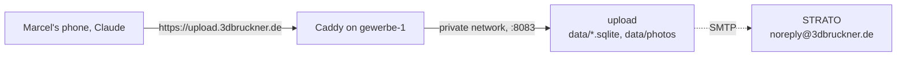

# Operating upload.3dbruckner.de

upload.3dbruckner.de is upload from `upload/` of this repository, on `products-1` (Hetzner, with notefeed.me, gesetze-fuer-ki.de and gamepanion.app), checked out at `/srv/stacks/3dbruckner/`. `MarcelBruckner-Business/ansible` deploys it: it writes `upload/.env` from its vault, starts the container, routes the name through Caddy on `gewerbe-1`, sets the DNS record at Cloudflare to `gewerbe-1` (proxy off, Caddy's own certificates) and runs the backups. Its `docs/products-1.md` has the commands.

## Settings

Every setting is in `upload/.env`, written by the deployment from its vault; `.env.example` lists the names. Sign-in is by emailed code and link, then a passkey; only the addresses in `UPLOAD_ALLOWED_EMAILS` may sign in. `PUBLIC_URL` is `https://upload.3dbruckner.de`: passkeys are bound to it, and so is every connected Claude. `UPLOAD_GITHUB_TOKEN` stays empty until the site reads upload's export; until then no change starts the site's build.

## Upgrading

upload has no releases yet: the image is `:main`, and each deployment pulls it (`pull_policy: always`). An upgrade is a merge in upload, CI publishing the image, then a deployment (`ansible-playbook site.yml --limit products-1`). The deployment takes a dump before it touches a changed checkout or `.env`; if that fails, nothing is changed. upload migrates its databases when it starts.

## Backups

`upload/scripts/dump.sh <kind> <days>` writes `data/dumps/<kind>-<time>/` with consistent, checked copies of `upload.sqlite` and `auth.sqlite` and the photos (hard links, so a dump costs almost no space). Timers on the server, set up by the deployment:

| Kind           | When                                                | Kept on the server |
| -------------- | --------------------------------------------------- | ------------------ |
| hourly         | every hour                                          | 1 day              |
| daily          | 03:25                                               | 30 days            |
| before-upgrade | each deployment that changes the checkout or `.env` | 1 day              |

There is no copy outside the server yet: the Storage Box copy (its own sub-account, like Gamepanion's) comes with the move of the site's prints.

`UPLOAD_SECRET` is in no backup: it is in the vault and in 1Password. A dump without it restores the prints and photos, but every browser and every Claude has to sign in again.
