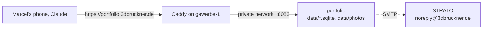
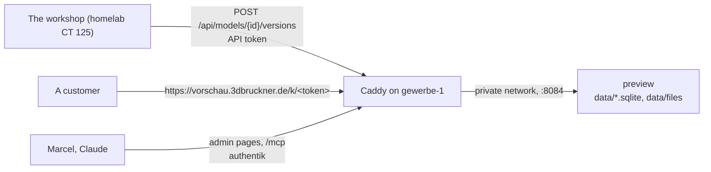

# Operating portfolio.3dbruckner.de

portfolio.3dbruckner.de is portfolio from `portfolio/` of this repository, on `products-1` (Hetzner, with notefeed.me, gesetze-fuer-ki.de and gamepanion.app), checked out at `/srv/stacks/3dbruckner/`. `MarcelBruckner-Business/ansible` deploys it: it writes `portfolio/.env` from its vault, starts the container, routes the name through Caddy on `gewerbe-1`, sets the DNS record at Cloudflare to `gewerbe-1` (proxy off, Caddy's own certificates) and runs the backups. Its `docs/products-1.md` has the commands.

## Settings

Every setting is in `portfolio/.env`, written by the deployment from its vault; `.env.example` lists the names. Sign-in is by emailed code and link, then a passkey; only the addresses in `PORTFOLIO_ALLOWED_EMAILS` may sign in. `PUBLIC_URL` is `https://portfolio.3dbruckner.de`: passkeys are bound to it, and so is every connected Claude. `PORTFOLIO_GITHUB_TOKEN` stays empty until the site reads portfolio's export; until then no change starts the site's build.

## Upgrading

portfolio has no releases yet: the image is `:main`, and each deployment pulls it (`pull_policy: always`). An upgrade is a merge in portfolio, CI publishing the image, then a deployment (`ansible-playbook site.yml --limit products-1`). The deployment takes a dump before it touches a changed checkout or `.env`; if that fails, nothing is changed. portfolio migrates its databases when it starts.

## Backups

`portfolio/scripts/dump.sh <kind> <days>` writes `data/dumps/<kind>-<time>/` with consistent, checked copies of `portfolio.sqlite` and `auth.sqlite` and the photos (hard links, so a dump costs almost no space). Timers on the server, set up by the deployment:

| Kind           | When                                                | Kept on the server |
| -------------- | --------------------------------------------------- | ------------------ |
| hourly         | every hour                                          | 1 day              |
| daily          | 03:25                                               | 30 days            |
| before-upgrade | each deployment that changes the checkout or `.env` | 1 day              |

There is no copy outside the server yet: the Storage Box copy (its own sub-account, like Gamepanion's) comes with the move of the site's prints.

`PORTFOLIO_SECRET` is in no backup: it is in the vault and in 1Password. A dump without it restores the prints and photos, but every browser and every Claude has to sign in again.

# Operating vorschau.3dbruckner.de

vorschau.3dbruckner.de is [preview](https://github.com/3D-Bruckner/preview) from `preview/` of this repository, in the same checkout on `products-1` as portfolio, deployed the same way by `MarcelBruckner-Business/ansible`: it writes `preview/.env` and the logo (`data/brand/logo.svg`), starts the container, routes the name through Caddy on `gewerbe-1`, sets the DNS record and runs the backups. Customers open their own link (`/k/<token>`) without signing in; the rest is Marcel's, through authentik.

## Settings

Every setting is in `preview/.env`, written by the deployment from its vault; `.env.example` lists the names. Sign-in is through authentik only (its application `preview`), and only the addresses in `PREVIEW_ALLOWED_EMAILS` get in. 3D Bruckner's name, colour, logo and legal links are set by the deployment, not here. `PUBLIC_URL` is `https://vorschau.3dbruckner.de`: every customer's link is built from it, so changing it breaks the links already sent.

## Upgrading

As portfolio: the image is `:main`, each deployment pulls it, a dump is taken before a deployment that changes the checkout or `.env`, and preview migrates its databases when it starts.

## Backups

`preview/scripts/dump.sh <kind> <days>` writes `data/dumps/<kind>-<time>/` with checked copies of `preview.sqlite` and `auth.sqlite` and the models' files (hard links). The timers are portfolio's: hourly (1 day), daily at 03:35 (30 days), before-upgrade (1 day). There is no copy outside the server yet. `preview/tests/restore.sh` runs the image twice, the second time on a restored dump, and checks the two answer the same; run it after changing `dump.sh`.

`PREVIEW_SECRET` is in no backup: it is in the vault and in 1Password. A dump without it restores customers, links and models, but Marcel and every Claude sign in again; the customers' links keep working (they are in the database, not signed with the secret).
